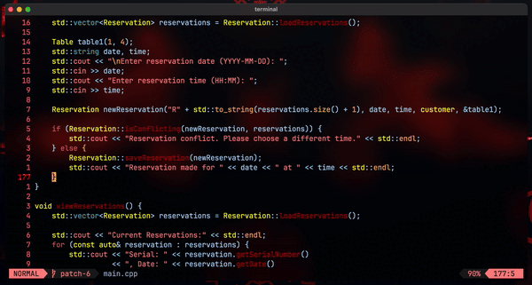

# tmux-compile.nvim

This project is discontinued (not archived to avoid breaking configs).

**Successor: [switchboard.nvim](https://github.com/karnull/switchboard.nvim)**

- Why switch: provides the same functionality plus:
  - Uses :term when not running inside a tmux session
  - Configurable commands (not limited to hardcoded run/debug)
  - Project-specific keybinding support

